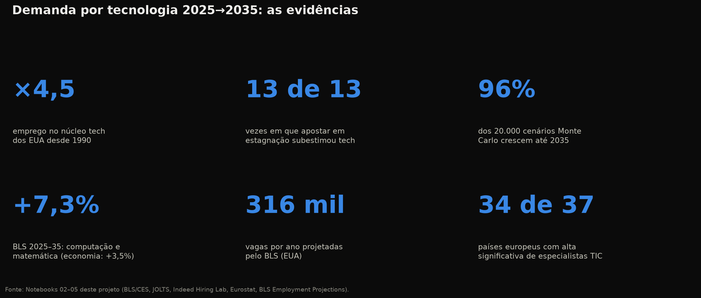
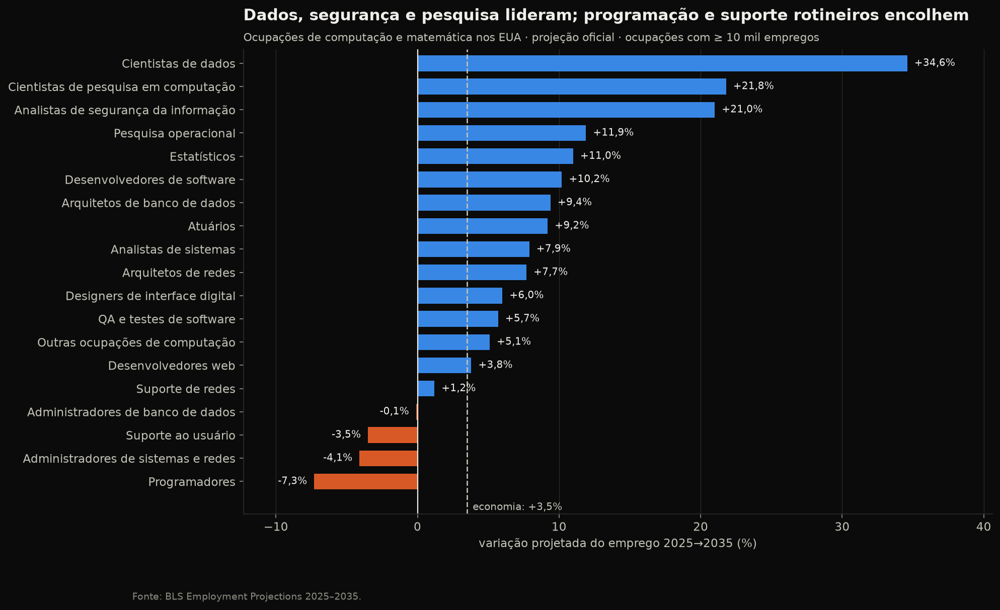

# Demanda por Trabalho em Tecnologia: 2025 → 2035

> **A demanda por profissionais de tecnologia vai aumentar ou diminuir nos próximos 10 anos?**
> Este projeto responde com **dados oficiais e reais**, mineração de dados e modelos validados fora da amostra.



## Veredito

**A demanda vai aumentar, mas de forma mais seletiva e mais lenta que na década de 2010.**

| Evidência | Resultado |
|---|---|
| Tendência de 35 anos (EUA) | emprego no núcleo tech **×4,5** desde 1990; participação no emprego total triplicou |
| Backtest de 10 anos | apostar em "sem crescimento" **subestimou o emprego tech em 13 de 13** origens testadas |
| Ensemble ponderado (backtest) | **+21%** até 2035 (intervalo empírico de 80%: +2% a +37%) |
| Monte Carlo (20.000 cenários) | **~96%** dos cenários terminam acima de 2025; mediana +35% |
| Projeção oficial BLS 2025–2035 | computação e matemática **+7,3%** vs. economia **+3,5%**, ~316 mil vagas/ano |
| Europa (Eurostat) | **34 de 37** países com alta estatisticamente significativa de especialistas em TIC |

**O que os dados também mostram:**
- O ciclo atual é real: o emprego tech recua desde dez/2022 (−5%), a 2ª maior queda desde 1990.
- A composição muda: **cientistas de dados (+34,6%)**, **segurança da informação (+21%)** e **pesquisa em computação (+21,8%)**
  crescem forte; **programadores (−7,3%)** e **suporte ao usuário (−3,5%)** encolhem.



## Fontes de dados (todas públicas)

| Fonte | Conteúdo | Cobertura |
|---|---|---|
| [BLS Current Employment Statistics](https://www.bls.gov/ces/) via [FRED](https://fred.stlouisfed.org/) | emprego mensal por setor (NAICS 5415, 518, …) | EUA, 1990 → hoje |
| [BLS JOLTS](https://www.bls.gov/jlt/) via FRED | vagas abertas no setor de Informação | EUA, 2000 → hoje |
| [Indeed Hiring Lab](https://github.com/hiring-lab/job_postings_tracker) | índice diário de anúncios de vaga por área | 6 países, 2020 → hoje |
| [Eurostat `isoc_sks_itspt`](https://ec.europa.eu/eurostat/databrowser/view/isoc_sks_itspt/default/table) | especialistas em TIC empregados | UE + 36 países, 2004 → hoje |
| [BLS Employment Projections](https://www.bls.gov/emp/) | projeção oficial por ocupação | EUA, 2025 → 2035 |

Os dados são baixados automaticamente e guardados em cache em `data/raw/` (fora do git).
O snapshot do BLS fica versionado em `data/external/` e é validado por testes (ver `data/external/README.md`).

## Técnicas utilizadas

| Etapa | Técnicas |
|---|---|
| Mineração de padrões | decomposição **STL robusta**, detecção de mudança de regime **PELT**, *event study* de **drawdowns**, **correlação cruzada** e **causalidade de Granger**, **K-Means + PCA** em trajetórias, **Mann-Kendall + Theil-Sen** |
| Previsão | **ETS amortecido**, **ARIMA** com seleção por AIC, **tendência Theil-Sen**, **backtesting com origem móvel**, **ensemble ponderado por desempenho**, **intervalos empíricos** (estilo conformal), **Monte Carlo com block bootstrap**, modelo estrutural de participação |
| Visualização | tema escuro com paleta validada para daltonismo (CVD), rótulos diretos, small multiples, *fan charts* |

## Estrutura

```
├── notebooks/
│   ├── 01_coleta_dados.ipynb          # coleta, cache e checagens de qualidade
│   ├── 02_analise_exploratoria.ipynb  # EDA: estrutura, ciclo e abrangência global
│   ├── 03_mineracao_padroes.ipynb     # 6 técnicas de mineração de dados
│   ├── 04_previsao_2035.ipynb         # backtest, ensemble, Monte Carlo, triangulação BLS
│   └── 05_conclusoes.ipynb            # onde estará a demanda + veredito
├── src/techdemand/                    # código reutilizável (importado pelos notebooks)
│   ├── config.py · data_sources.py · features.py
│   ├── analysis.py · models.py · style.py
├── tests/                             # pytest: integridade dos dados, features, análises e modelos
├── data/{raw,processed,external}/
└── reports/figures/                   # todos os gráficos em PNG (fundo preto)
```

## Como executar

```bash
python3 -m venv .venv && source .venv/bin/activate
make install      # dependências + pacote em modo editável
make test         # testes automatizados (pytest)
make notebooks    # executa os 5 notebooks em ordem e regenera os gráficos
```

Requer Python ≥ 3.11 e acesso à internet na primeira execução.

## Limitações

- Emprego setorial (CES) ≠ ocupações (BLS EP): empresas tech empregam não técnicos, e técnicos trabalham fora delas.
- Modelos extrapolam padrões históricos; choques sem precedente (ex.: adoção acelerada de IA) não estão no histórico.
- A série europeia tem quebra em 2011 (ISCO-08); só o período posterior é modelado, e seu Monte Carlo subestima o risco.
- Brasil não incluído por falta de série pública comparável por ocupação tech com histórico longo.

## Fluxo de trabalho Git

Veja [CONTRIBUTING.md](CONTRIBUTING.md).
